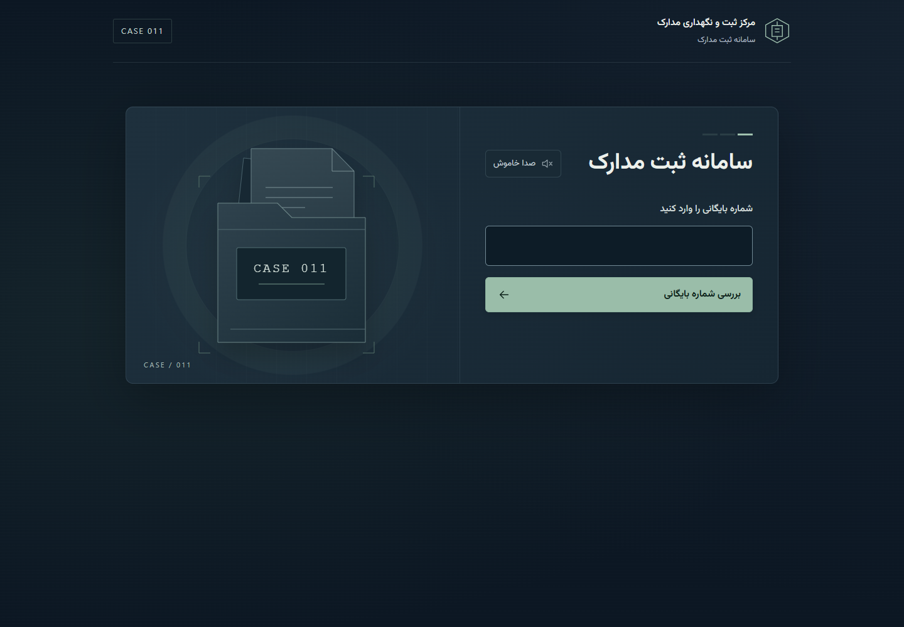
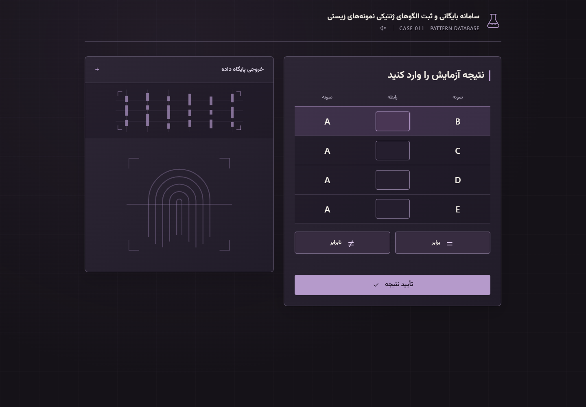
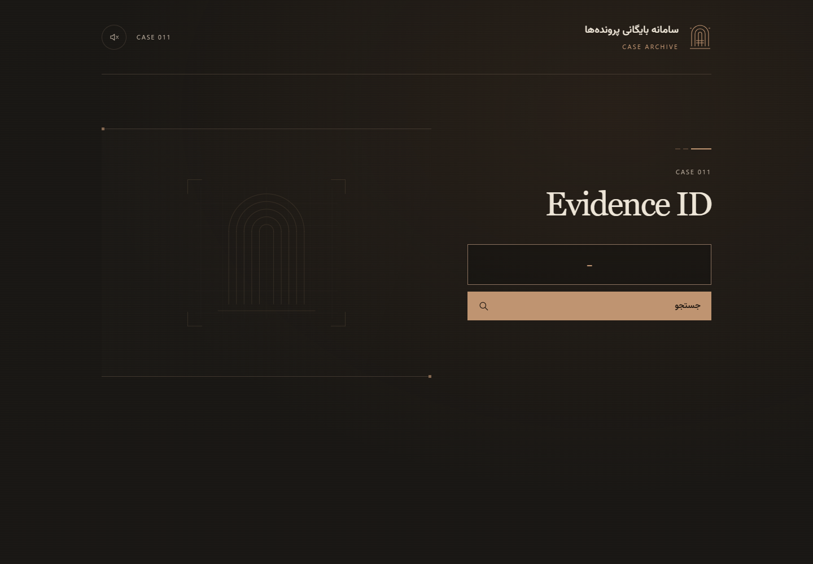
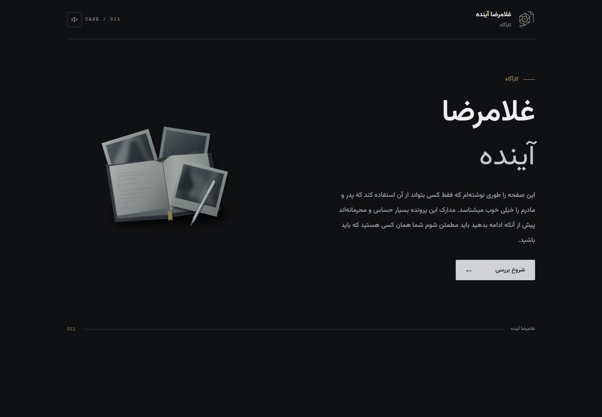

# CASE 011

CASE 011 is a fictional murder-mystery investigation game played with physical evidence, printed materials, and puzzles. This repository contains the game's **web component**: four independent Persian-language portals that players visit during the investigation.

These are fictional in-game interfaces, not real government, police, forensic, or identity-verification services. The repository does not contain the complete physical game.

**Spoiler notice:** the source code, configuration, evidence files, and technical documentation contain puzzle solutions and story spoilers. The screenshots below show only the initial landing screens.

## Portals

| Portal | Role in the game | Direct path |
| --- | --- | --- |
| Entry 1 | A fictional document-registration and case-access portal, with internal dossier, evidence, and PDF views. | `/entry-1/` |
| Entry 2 | A fictional biological-pattern database, with comparison inputs and staged record views. | `/entry-2/` |
| Entry 3 | A fictional case archive and recovered-evidence interface, including an evidence-recording player. | `/entry-3/` |
| Entry 4 | The fictional detective's personal site, with familiarity checks and progressively revealed hints. | `/entry-4/` |

Each portal has its own direct URL intended for its own QR code. There is no cross-entry navigation; each entry may contain several internal views. The client-side puzzle gates are game mechanics, not production authentication.

## Screenshots

Initial landing screens at a desktop viewport of 1440 × 1000.

| Entry 1 — Document registration | Entry 2 — Biological-pattern database |
| --- | --- |
|  |  |
| **Entry 3 — Case archive** | **Entry 4 — Detective's personal site** |
|  |  |

## Technology

- HTML, CSS, and vanilla JavaScript; Entry 4 uses JavaScript modules.
- Persian right-to-left interfaces with the self-hosted Vazirmatn font, responsive layouts, and reduced-motion styles.
- Browser-native PDF and audio playback, plus synthesized interaction effects through the Web Audio API.
- A shared background-music utility used by all four entries.

There is no application backend, database, package installation, or build step. The existing verification scripts in `tests/` use Node.js; Node.js is not required to serve or play the game.

## Local preview

From the repository root, serve `public/` over HTTP:

```sh
python -m http.server 8001 --directory public
```

Open any portal directly:

- [Entry 1](http://localhost:8001/entry-1/)
- [Entry 2](http://localhost:8001/entry-2/)
- [Entry 3](http://localhost:8001/entry-3/)
- [Entry 4](http://localhost:8001/entry-4/)

Python 3 is only a convenient local static server, not an application runtime dependency. Another static server can be used if it supports HTTP HEAD requests for the evidence-file availability checks. Opening files directly with `file://` is insufficient for these checks and Entry 4's JavaScript modules. Enable JavaScript in the browser.

Background music starts off. Its toggle controls music only; interaction effects activate through user interaction. Recording playback temporarily suppresses decorative audio while preserving the existing music pause/resume behavior and explicit mute choice. Hidden pages suspend decorative audio.

For static hosting, use `public/` as the document root and preserve the four entry paths and their assets. Serve each entry's own `index.html`; do not route all four paths to one shared page.

## Repository layout

```text
public/                  Static site root
  entry-1/               Document-registration portal and evidence PDFs
  entry-2/               Biological-pattern database portal
  entry-3/               Case archive and evidence player
  entry-4/               Detective's site, content configuration, and assets
  shared/                Shared foundation styles and audio utility
docs/screenshots/        Four initial-screen captures used above
tests/                   Existing Node.js and browser verification scripts
LICENSE                  MIT license for project-owned source code
```

Each entry keeps its own HTML, CSS, JavaScript, and assets. [Entry 4's technical notes](public/entry-4/DEVELOPMENT.md) describe its content configuration and browser verification; they contain spoilers.

## Credits and licensing

Project-owned source code and technical documentation are licensed under the [MIT License](LICENSE), copyright Parsa Haji Adineh. This license does not grant rights to the game's story, dialogue, evidence documents, recordings, images, music, fonts, or third-party media. Preserve the separate notices and terms below when reusing assets.

### Music

Background music by Kevin MacLeod ([Incompetech](https://incompetech.com/)), licensed under [Creative Commons Attribution 4.0 International](https://creativecommons.org/licenses/by/4.0/):

| Used in | Track and official source | Artist |
| --- | --- | --- |
| Entry 1 | [Lightless Dawn](https://incompetech.com/music/royalty-free/index.html?Search=Search&isrc=USUAN1100655) | Kevin MacLeod ([incompetech.com](https://incompetech.com/)) |
| Entry 2 | [Dark Fog](https://incompetech.com/music/royalty-free/index.html?Search=Search&isrc=USUAN1300031) | Kevin MacLeod ([incompetech.com](https://incompetech.com/)) |
| Entry 3 | [Echoes of Time](https://incompetech.com/music/royalty-free/index.html?Search=Search&isrc=USUAN1300029) | Kevin MacLeod ([incompetech.com](https://incompetech.com/)) |
| Entry 4 | [Nervous](https://incompetech.com/music/royalty-free/index.html?Search=Search&isrc=USUAN1100139), tagged “Nervous Piano” in the installed file | Kevin MacLeod ([incompetech.com](https://incompetech.com/)) |

Each entry stores its track at `assets/audio/background.mp3` and loops it at reduced playback volume. The files' prior editing history is undocumented. These tracks remain under their own license, not MIT.

### Font and other media

- **Vazirmatn** — Copyright 2015 The Vazirmatn Project Authors. The self-hosted font is documented as coming from the [official v33.003 release](https://github.com/rastikerdar/vazirmatn/tree/v33.003) and retains its [SIL Open Font License 1.1](public/entry-1/assets/fonts/OFL.txt).
- **Other game media** — Authorship and redistribution permissions for portraits, puzzle images, evidence PDFs, illustrations, and evidence recordings are not fully documented. These assets are not covered by the MIT license.
